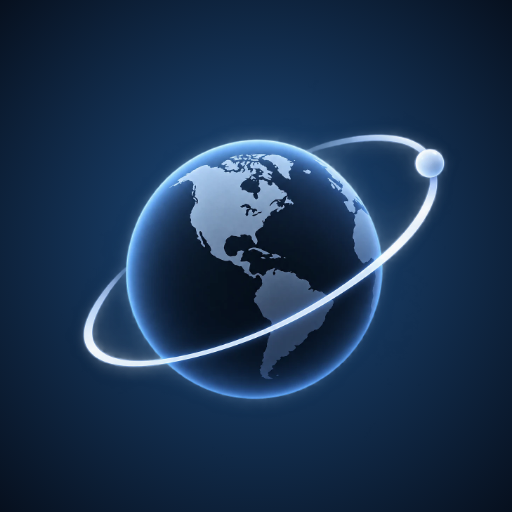

<div align="center">



# Orbit

**A live 3D globe for watching the world — planes, satellites, ships, cameras, weather and conflicts, all in your browser.**

<br>


</div>

---

## ✨ What can it do?

Turn things on and off from the **Data layers** menu on the left. Each section folds away with a click on its heading, and Orbit remembers how you left it. Switch a layer on and the other sections fold up automatically, so that layer's own settings (aircraft filters, camera search and so on) slide up into view. On a phone the menu also closes itself so you can see the map; open Layers again to reach the settings.

| | Layer | What you see |
|---|---|---|
| ✈️ | **Aircraft** | Live planes, each icon pointing the way it's flying. Click one for its photo, speed, altitude and a 24-hour path. |
| 🛰️ | **Satellites** | Thousands of satellites in orbit. Search by name, number or operator (e.g. *starlink*). |
| 🚢 | **Ships** | Vessels near ports and coasts. |
| 📷 | **Cameras** | Live public traffic and web cameras. |
| 🚓 | **ALPR** | Mapped license-plate readers, with an option to plan a route that avoids them. |
| 🏢 | **Data centers & 3D Photo** | Server farms, and photorealistic 3D cities. Turn on **3D PHOTO**, then press the ✈ icon in the top bar for **Fly mode** (W A S D to glide between the buildings, Esc to leave). |
| 🌦️ | **Weather** | Wind, rain radar, clouds, lightning and cyclones. |
| 🌋 | **Events** | Earthquakes, active fires and the **Conflict watch**. |
| 🌊 | **Infrastructure** | Undersea cables, dams, **power plants** (coloured by fuel, sized by output) and the **power grid**: high-voltage lines and substations that load as you zoom into a region. |
| 📻 | **Radio & launches** | Live radio stations, and rocket launches with an ascent replay and a **Watch** button that plays the livestream (YouTube in the page; X, NASA+ and others open in a new tab). |
| 🕰️ | **Time machine** | Scrub back through time to see how things looked. |

### 🔎 Search, directions and "my location"

- **Search bar (top)** — find a place, a store (*pharmacy*, *walmart*), a flight (*DAL123*), a satellite or ALPR cameras.
- **📍 button** — fly to where you are. Your browser will ask permission first, and your location never leaves your device except as a "search near me" hint.
- **Directions** — plan a route, optionally avoiding mapped ALPR cameras.

### ⚔️ Conflict watch

Follow **Russia–Ukraine**, **Israel–Gaza** and other active conflicts on the map.
Drag the date slider (or press **Play**) to watch events unfold, and read the latest headlines in the panel.
It can also follow the Time machine's date.

> Event data comes from the Uppsala Conflict Data Program and lags about a month. Death counts are estimates.

---

## 🚀 Get it running

You need **[Node.js](https://nodejs.org/) 18 or newer**. That's it.

**1. Download**

```bash
git clone https://github.com/runna5k/Orbit.git
cd Orbit
npm install
```

**2. Add your keys (optional)**

Orbit works with **no keys at all**: the globe, aircraft, satellites, cameras, weather, events and infrastructure all load on a fresh clone. A few things need a free key, and the app tells you which, where to get it and where to paste it (the 🔑 **Keys menu**). Skip this step and add keys later from the app if you like.

```bash
copy env.example .env.local        # Windows
cp env.example .env.local          # Mac / Linux
```

Open `.env.local` and fill in whatever you have (see the table below).

**3. Start it**

```bash
npm run dev
```

Open **http://localhost:5173** — you're in. 🎉

---

### 📡 Open it on your phone or another computer (same Wi-Fi)

```bash
npm run dev:lan
```

Vite prints a **Network** address such as `http://192.168.1.20:5173` — open that on the other device. The first time, Windows may ask whether Node.js can talk on your network: choose **Allow**. Two things to know: anyone on your network can open it while it runs, and browsers only allow the 📍 location button on `localhost` or `https`, so it won't work over a plain `http://` address.

---

## 🔑 Keys (all optional)

The quickest way: press the **🔑 key icon** in the top bar (on a phone, the key button in the bottom bar) and paste your tokens into the form. **Cesium ion** and **N2YO** are saved in your browser; the server keys (**AISStream, OpenSky, ADS-B Exchange, KeepTrack, NASA FIRMS**) are written to .env.local on the computer running Orbit, and can only be changed from that computer. The table below is for doing the same by hand.


| Key | Unlocks | Without it | Where to get it |
|---|---|---|---|
| `VITE_CESIUM_ION_TOKEN` | Aerial imagery, terrain, 3D Photo | Esri satellite imagery, flat terrain, no 3D Photo | [ion.cesium.com/tokens](https://ion.cesium.com/tokens) (free) |
| `AISSTREAM_API_KEY` | Ships near coasts worldwide | Only the Baltic shows | [aisstream.io](https://aisstream.io/apikeys) (free) |
| `OPENSKY_CLIENT_ID` / `OPENSKY_CLIENT_SECRET` | More reliable aircraft data | Keyless community feeds (adsb.lol, adsb.fi, airplanes.live) | [opensky-network.org](https://opensky-network.org/) (free) |
| `KEEPTRACK_API_KEY` | Fuller satellite catalog | CelesTrak, then SatNOGS | [keeptrack.space](https://keeptrack.space/) |
| `FIRMS_MAP_KEY` | Satellite-detected fire hot-spots | Fires from NASA EONET | [NASA FIRMS](https://firms.modaps.eosdis.nasa.gov/api/map_key/) (free) |
| `ADSBX_API_KEY` | A third aircraft feed | The free feeds above already cover it | [adsbexchange.com](https://www.adsbexchange.com/data/) (paid) |

Keys that start with `VITE_` are visible in the browser. The others stay on the server. Never share your `.env.local` file.

The N2YO key has no `.env.local` setting: paste it in the Keys menu (it stays in your browser).

---

## 📲 Install it as an app

Orbit is an installable web app (a PWA). Once your own local copy is running (see the quick start above), it can sit on your home screen and open full-screen with its own icon. The licence allows this for personal learning and evaluation; it does not cover hosting Orbit for other people.

- **iPhone / iPad (Safari):** Share button → **Add to Home Screen**.
- **Android (Chrome):** menu → **Install app** (or **Add to Home screen**).
- **Desktop (Chrome / Edge):** the install icon at the right end of the address bar.

The installed app caches only its own pages and the globe library (so it opens fast and the frame shows without a connection). Live data is never cached: aircraft, ships, cameras and the rest always come from the network. Browsers allow that cache only on `https://` or `localhost`, so over a plain `http://` Wi-Fi address you still get the home-screen icon but not the offline frame. Orbit needs its small local server (`npm run dev`, or `server/index.ts`) for the live layers, so it isn't a stand-alone offline app.

**Windows app.** `npm run build:exe` builds a stand-alone `Orbit.exe` (Electron, with the local server inside) in
`exe-out/`, plus a zip of the folder. It listens on this computer only, and the keys you save in it stay in your own
user folder, never next to the program. It is not code-signed, so Windows will warn about an unknown publisher the
first time. Like the rest of Orbit, it's for your own use under the licence below.

---

## 🧭 Using the globe

| | Mouse | Touchpad | Touchscreen |
|---|---|---|---|
| **Spin** | Drag | One-finger drag | One finger |
| **Zoom** | Scroll wheel | Two-finger scroll or pinch | Pinch |
| **Tilt** | Right-drag or middle-drag | Hold **Shift** (or Alt / Ctrl) and drag | Two-finger drag |

- The little pad (**🌐 + − ⌃ ⌄ ◆**) works on any device: the globe button eases you all the way back out to the whole Earth, **+ / −** zoom in and out in big smooth steps (each − tap triples your height), and the others tilt and snap back to north-up and straight-down.
- On a touchscreen a pinch is tuned to be quick: about **8 pinches** take you from the whole Earth down to city level (and back out again), and a flick keeps gliding for a moment.
- **Click** anything to open its info card. Press **×** (or Esc) to close it and the camera returns to the normal view.
- On desktop, panels open in a column on the **right**, under the selection card.

### 📱 On a phone

The top bar has three buttons: **Map** (3D Photo and weather imagery), **Layers** (everything else) and a **light/dark switch**. The menus drop down from the bar, and tapping the globe tucks them away. The Follow / 24 h path bar becomes a simple two-button switch.

### 🔋 Smooth and sharp on phones

On a phone or tablet Orbit draws in two qualities and switches by itself: **sharp when you're still** (high resolution, edge smoothing, fine imagery, detailed 3D Photo) and a **lighter picture while you pan or pinch**, sharpening again a moment after you let go. It also shows an evenly spread sample of the satellites (about 3,000 at a time instead of all ~16,000, only those facing you), and downloads map tiles over more parallel connections. Desktop shows everything at full quality.

### 🗺️ Imagery: switch the picture of the Earth

In the menu, **Imagery** swaps between **Aerial** (Cesium ion / Bing, needs the free token), **Esri** (free satellite photos plus place names, no key needed, a separate fast network) and **Streets** (OpenStreetMap). If one can't be reached, Orbit falls back to the next automatically, and it remembers your choice.

### 🌗 Light or dark

Press the half-moon icon in the top bar to switch between the dark bar and a light, frosted-glass one. Orbit remembers your choice. Left on its own, the bar (and the text in the search box) also turns light or dark by itself depending on how bright the map is behind it.
---

## 🛟 Something not working?

| Problem | Try this |
|---|---|
| Blank globe | Wait a few seconds, then refresh the page. |
| No planes | Make sure you started with `npm run dev` (not `dev:vite`), so the server is running. |
| No ships | Add an `AISSTREAM_API_KEY`, then zoom to a port — open-ocean ships aren't covered. |
| 📍 says blocked | Allow location for the site from your browser's address bar, then try again. |
| Store search finds nothing | It only knows what OpenStreetMap has, and only searches within a few hundred km. |

---

## 📚 Learn more

- [DATA_SOURCES.md](./DATA_SOURCES.md) — where every piece of data comes from and its limits
- [ALPR_ADAPTER.md](./ALPR_ADAPTER.md) — how the ALPR layer works

<details>
<summary><b>For developers</b></summary>

<br>

**Stack:** Vite + TypeScript client (CesiumJS) in `src/`, an Express API in `server/`, shared types in `shared/`.

| Command | What it does |
|---|---|
| `npm run dev` | Starts the API server (port 8787) and Vite together |
| `npm run dev:vite` | Client only |
| `npm run build` | Typecheck and build for production |
| `npm run build:release` | The same, with no env file and no `VITE_` value read, then scans the output for tokens (use it for any build you install, so no key ends up inside) |
| `npm run build:exe` | Builds the Windows app (`exe-out/Orbit-win32-x64/Orbit.exe` and a zip) from a release build |
| `npm run preview` | Serve the production build |
| `npm test` | Unit tests |
| `npm run test:e2e` | Browser tests against the dev server |
| `npm run test:e2e:zerokey` | Browser tests with no keys at all (its own servers) |
| `npm run test:e2e:pwa` | Browser tests of the installable app (builds a release first) |

Optional layers live in `src/layers/` — each one registers itself with the layer host and appears as a chip in the Data layers menu.
To run a build on your own machine, start `server/index.ts` and set `VITE_PLANE_API_BASE` if the API is on a different address. Hosting Orbit for others, or offering it as a service, needs written permission (see the licence).

</details>

---

## ⚖️ Data and license

Data belongs to its providers (OpenStreetMap contributors under the [ODbL](https://wiki.openstreetmap.org/wiki/Open_Database_License), UCDP under CC BY 4.0, OpenSky, Airplanes.live, CelesTrak, AISStream and others) and is subject to their terms.

Orbit is **source-available, not open source.** The code is under the [Orbit Restricted Source License](./LICENSE). In short:

- **You may** read it, clone it, and run, modify or build your own local copy for personal learning, evaluation, or to contribute to this project (AI coding assistants working on your local copy are fine).
- **You may** fork it on GitHub to propose changes to this project.
- **You need written permission** to republish or redistribute it, use it commercially, sell or sublicense it, host it as a service for others, scrape or mirror the repository, or use it to train or evaluate AI/ML models.

The [LICENSE](./LICENSE) file is the full text and wins over this summary. For anything it doesn't cover, contact the repository owner.


