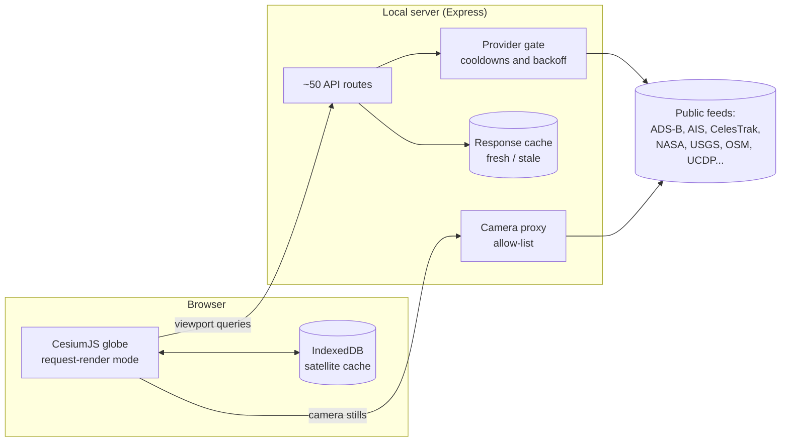

<p align="center">
  
</p>

<h1 align="center">Orbit</h1>

<p align="center">
  A live 3D globe of aircraft, satellites, ships, public cameras, weather and world events,
  built on free public data and run on your own machine.
</p>

<!-- Screenshot: full globe, desktop, a few layers on (aircraft + satellites). Save as docs/images/hero.png -->

Orbit pulls more than twenty public feeds into one CesiumJS globe. A small Express server does the fetching, merging,
caching and failover, and the browser only draws. It works on a fresh clone with no API keys, runs smoothly on a phone,
installs as a web app, and builds into a stand-alone Windows app.

It is a personal project, built to answer a simple question well: *what is happening on Earth right now, and how do you
show it honestly?* Every layer states what it covers and what it doesn't, nothing simulated is presented as live, and a
source that can't be used cleanly is left out rather than worked around.

## What it shows

| Layer | Details |
|---|---|
| Aircraft | Live positions merged from several ADS-B feeds. Select a plane for its photo, altitude, speed and 24-hour track. |
| Satellites | About 16,000 objects propagated in the browser from orbital elements. Search by name, NORAD number or operator. |
| Ships | AIS positions near ports and coastlines. |
| Cameras | Public traffic cameras from 22 agency feeds across North America, Europe, Hong Kong and New Zealand. |
| ALPR | Mapped license-plate readers from OpenStreetMap, with estimated view cones and routing that avoids them. |
| Weather | Wind particles, radar, cloud imagery, lightning and tropical cyclones. |
| Events | Earthquakes, wildfires and a conflict timeline (UCDP data, roughly a month behind). |
| Infrastructure | Undersea cables, dams, data centers, power plants by fuel and output, and the high-voltage grid. |
| Launches and radio | Upcoming rocket launches with livestream links, and live radio stations. |
| 3D cities | Photorealistic 3D tiles with a fly mode (W A S D) for moving between buildings. |
| Time machine | Scrub back through recorded history. The conflict layer can follow it. |

Search (top bar) finds places, stores, flights, satellites and cameras. Directions can route around mapped ALPR cameras.

<!-- Screenshots, side by side: an aircraft selected with its track, the camera layer with a live still, and the phone layout. Save in docs/images/ -->

## Quick start

Requires [Node.js](https://nodejs.org/) 18 or newer.

```bash
git clone https://github.com/stonefnc/Orbit.git
cd Orbit
npm install
npm run dev
```

Open <http://localhost:5173>. `npm run dev` starts the API server on port 8787 and the Vite client together. The client
alone (`npm run dev:vite`) loads the globe but no live layers.

To open it from a phone on the same Wi-Fi, run `npm run dev:lan` and use the Network address Vite prints. Anyone on
that network can reach it while it runs, and browsers only allow geolocation on `localhost` or `https`.

### API keys (optional)

Everything above works with no keys. Keys unlock more coverage and are entered in the in-app Keys menu or in
`.env.local` (copy `env.example`).

| Variable | Adds | Without it |
|---|---|---|
| `VITE_CESIUM_ION_TOKEN` | Aerial imagery, terrain, 3D cities | Esri imagery, flat terrain |
| `AISSTREAM_API_KEY` | Coastal ships worldwide | Baltic only |
| `OPENSKY_CLIENT_ID` / `OPENSKY_CLIENT_SECRET` | A more reliable aircraft feed | Keyless community feeds |
| `KEEPTRACK_API_KEY` | A fuller satellite catalog | CelesTrak, then SatNOGS |
| `FIRMS_MAP_KEY` | Satellite fire detections | NASA EONET fires |
| `ADSBX_API_KEY` | A third aircraft feed (paid) | Not needed |

Variables starting with `VITE_` are visible to the browser. The rest stay on the server.

## How it works



**The browser draws. The server fetches.** The client never calls most providers directly. The server holds the keys,
merges overlapping feeds, caches results, backs off after errors and keeps serving the last good answer when an upstream
goes down.

### Aircraft pipeline

1. A viewport request is snapped to a 0.1° grid (about 11 km), so panning and multiple tabs share one upstream call.
2. Identical requests within 4 seconds are answered from cache, and concurrent identical requests share a single
   in-flight fetch.
3. On a miss, OpenSky (if configured), ADS-B Exchange (if configured) and a keyless chain of adsb.lol, adsb.fi and
   airplanes.live are queried in parallel, and the results are merged and de-duplicated by aircraft.
4. Each provider sits behind a gate that records failures and applies an exponential cooldown (or honors
   `Retry-After`), capped at 15 minutes.
5. If every provider fails, the last good response is served for up to 90 seconds and marked stale.

### Satellites

Orbital elements come from CelesTrak's active catalog, then KeepTrack (with a key), then SatNOGS merged over the last
known full catalog, so a blocked provider never empties the layer. CelesTrak is polled no faster than it republishes
(about every two hours). Positions are propagated in the browser with SGP4 (satellite.js), and the catalog is kept in
IndexedDB so reloads are instant. An earlier `localStorage` cache silently exceeded its quota, so IndexedDB replaced it.

### Rendering

- **Render on demand.** Cesium runs in request-render mode, so the scene redraws only when data or the camera changes
  rather than 60 times a second. This is what makes the phone experience workable.
- **Horizon culling.** Markers on the far side of the Earth are hidden by comparing their distance to the computed
  horizon distance, recalculated in 2% steps so vertex data is rewritten on zoom, not on every pan frame.
- **Two qualities on touch devices.** At rest a phone renders at high resolution with anti-aliasing and fine terrain.
  While a finger is moving it drops to a lighter preset and sharpens again after release. Desktops are untouched.
- **Clustering by altitude.** Markers cluster when zoomed out and un-cluster below a set camera height. Markers sharing
  one coordinate (several cameras on a pole) fan out into a small ring so each stays clickable.

### Security and privacy

Orbit is designed to run on one person's computer, and the defaults reflect that.

- **Camera proxy.** The browser only ever receives an Orbit URL. The server fetches stills from a per-source allow-list
  over HTTPS, re-checks every redirect, caps response size and verifies the file's leading bytes before passing it on.
  It identifies itself honestly, and sources that block non-browser clients are left out instead of spoofed.
- **Keys.** Server keys can only be changed from the machine running Orbit and are never sent back to the page.
- **Network exposure.** The AIS websocket accepts browser connections only from this computer or, in LAN mode, from a
  page whose origin is a private IPv4 literal matching the host it was served from. DNS names are rejected, which closes
  off DNS-rebinding.
- **Release builds.** `npm run build:release` builds with no env files and no key variables, then scans its own output
  for token-shaped strings and fails if it finds one.

## Testing

| Command | Covers |
|---|---|
| `npm test` | 21 unit-test files (about 170 tests): route math, bounding boxes, horizon math, settings, provider parsing |
| `npm run test:e2e` | Browser smoke tests against the dev server at desktop and phone sizes |
| `npm run test:e2e:zerokey` | Starts both servers with an empty settings folder and checks that keyless layers load and keyed layers explain themselves instead of failing |
| `npm run test:e2e:pwa` | Builds a release and tests the installable app |

## Running it elsewhere

- **As an app:** Orbit is a PWA. Once it is running locally, use your browser's "Install app" or "Add to Home Screen".
  Only the app shell is cached. Live data always comes from the network.
- **On Windows:** `npm run build:exe` produces a stand-alone `Orbit.exe` (Electron with the server inside) in
  `exe-out/`. It listens on this computer only and keeps saved keys in your user folder. It is not code-signed, so
  Windows will warn about an unknown publisher.

## Known limitations

- Ships are coastal only. Free AIS is land-based, and open-ocean coverage requires paid satellite AIS.
- No cameras in South America or Africa yet. Every source found there requires a per-user key.
- Several feeds are providers' own map endpoints rather than documented APIs and can change without notice.
- `src/main.ts` is large (about 5,500 lines). The layer code around it is modular.
- It is built for one user on one machine. Hosting it for others would need accounts, secret storage, per-user rate
  limits and a review of each provider's commercial terms.

## Project layout

```
src/            Browser client (TypeScript, CesiumJS)
  layers/       Toggleable layers, each registered with the layer host
  providers/    Client-side feed adapters
  alpr/         ALPR layer, adapters and view-cone geometry
server/         Express API: feed fetching, merging, caching, camera proxy
  lib/          One module per data source plus shared fetch, cache and gate logic
  cctv/         Camera registry and per-agency source adapters
shared/         Types shared by client and server
tests/          Vitest unit tests and Playwright browser suites
scripts/        Release build, Windows build and data-generation scripts
docs/           Design notes
```

Further reading: [DATA_SOURCES.md](./DATA_SOURCES.md) lists every source, its terms and its limits.
[ALPR_ADAPTER.md](./ALPR_ADAPTER.md) explains the ALPR layer, and [docs/CaseStudy.md](./docs/CaseStudy.md) covers the
decisions behind the project.

## Data and license

Data belongs to its providers (OpenStreetMap contributors under the
[ODbL](https://wiki.openstreetmap.org/wiki/Open_Database_License), UCDP under CC BY 4.0, OpenSky, Airplanes.live,
CelesTrak, AISStream and others) and is subject to their terms. Attributions are shown in the app's Credits sheet.

Orbit is **source-available, not open source**, under the [Orbit Restricted Source License](./LICENSE). You may read,
clone, run and modify a local copy for personal learning or evaluation, and fork it to propose changes. Redistribution,
commercial use, hosting it for others, scraping or mirroring the repository, and using it to train or evaluate AI/ML
models require written permission. The LICENSE file is the full text and takes precedence over this summary.
